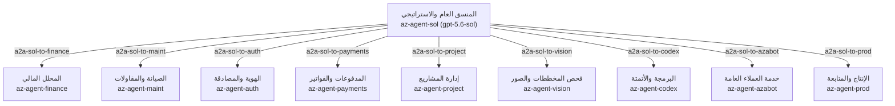

# تقرير الجرد المؤسسي الشامل لمنصة Microsoft Azure AI Foundry
**منظومة العزب للذكاء الاصطناعي — Alazab Enterprises**
*تاريخ وتوقيت الجرد:* `2026-11-13T09:01:50.541Z`
*بيئة المشروع:* `az-ai-gateway` (`azab-rg-ai` / `eastus2`)

---

## 1. ملخص المؤشرات العامة (Inventory KPI Dashboard)

| المكون المفحوص | العدد المكتشف | الحالة التشغيلية |
| :--- | :---: | :---: |
| **النماذج المنشورة (Model Deployments)** | **5** | ✅ نشطة وموزعة بسعات استدلالية |
| **وكلاء الذكاء الاصطناعي (Registered Agents)** | **10** | ✅ معرفة وموثقة بإصداراتها |
| **قنوات وتكاملات الربط (Project Connections)** | **35** | ✅ تشمل AISearch, MCP, Speech, REST |
| **روابط التنسيق بين الوكلاء (A2A Mesh Links)** | **11** | ✅ شبكة أسراب موجهة للوكيل Sol |
| **صناديق أدوات فوندري (Foundry Toolboxes)** | **5** | ✅ تغطي دفترة، أوبرفيكس، ماجيك بلان، واتساب |

---

## 2. النماذج المنشورة وسعات الاستدلال (Model Deployments & Capacities)

| اسم النشر (Deployment Name) | النموذج الأصلي (Model) | الناشر (Publisher) | الإصدار | السعة (SKU / Capacity) | القدرات (Capabilities) |
| :--- | :--- | :--- | :---: | :--- | :--- |
| `az-model-finance` | **DeepSeek-V4-Pro** | DeepSeek | 2026-04-23 | GlobalStandard (250) | chat_completion |
| `az-models-text` | **text-embedding-3-small** | OpenAI | 1 | GlobalStandard (532) | embeddings |
| `az-model-sol` | **gpt-5.6-sol** | OpenAI | 2026-07-09 | GlobalStandard (2500) | chat_completion |
| `az-model-codex` | **gpt-5.3-codex** | OpenAI | 2026-02-24 | GlobalStandard (10000) | General |
| `az-model-gemma` | **google--gemma-4-31b-it** | azure-huggingface | 5 | GlobalManagedCompute (2) | General |

---

## 3. وكلاء فوندري المعتمدون (AI Agents Registry)

| الوكيل (Agent Name) | النموذج المربوط | الإصدار | عدد الأدوات | الدور الوظيفي ونطاق العمل |
| :--- | :--- | :---: | :---: | :--- |
| `az-agent-auth` | **az-model-sol** | v11 | 4 | أنت مسؤول عن مساعدة المستخدمين في مشاكل الدخول، التحقق، ربط الحسابات، فهم حالة الحساب، وتوجيه المستخدم إلى التطبيق أو ال |
| `az-agent-prod` | **az-model-sol** | v13 | 7 | الوكيل المسؤول عن المنتجات والخدمات إدارة الأصناف والمخازن والحركات المخزنية  |
| `az-agent-vision` | **az-model-sol** | v5 | 1 | وكيل الرؤية الحاسوبية والتحليل البصري الذكي |
| `az-agent-payments` | **az-model-finance** | v6 | 3 | Previous agent v4 plus daftra MCP toolboxes |
| `az-agent-finance` | **az-model-finance** | v7 | 2 | أنت وكيل التحليل المالي والإداري للعزب. وظيفتك تحليل البيانات المالية، المصروفات، الإيرادات، الفواتير، مؤشرات الأداء، وم |
| `az-agent-maint` | **az-model-sol** | v34 | 5 | كيف يمكنني مساعدتك اليوم ؟ |
| `az-agent-azabot` | **az-model-sol** | v11 | 7 | UberFix v2 connection target fix; preserves agent v10 configuration |
| `az-agent-project` | **az-model-sol** | v8 | 2 | Upgrade MCP URLs only from agent v7: magicplan v3 to v4 |
| `az-agent-sol` | **az-model-sol** | v9 | 12 | وكيل تخصصي لمنظومة العزب |
| `az-agent-codex` | **az-model-codex** | v5 | 2 | Head of Development, Systems, IT, Infrastructure |

---

## 4. تكاملات الاتصال والخدمات الخارجية (Connections & Integrations)

| اسم الاتصال (Connection Name) | التصنيف والنوع | الهدف / الرابط (Target Endpoint) | المصادقة |
| :--- | :--- | :--- | :--- |
| `FoundryMCPServerpreview` | **External Tool / MCP** (RemoteTool) | `https://mcp.ai.azure.com` | `UserEntraToken` |
| `AzureSpeechMCPServer` | **External Tool / MCP** (RemoteTool) | `https://az-ai-resource.cognitiveservices.azure.com/speech/mcp?api-version=2025-11-07-preview` | `CustomKeys` |
| `aisearchazabrgai13631b8blqr` | **Knowledge / Vector Search** (CognitiveSearch) | `https://aisearchazabrgai136311.search.windows.net/` | `ApiKey` |
| `az-uberfix-mcp` | **External Tool / MCP** (RemoteTool) | `https://az-ai-gateway.azure-api.net/tool-az-ai-gateway-alazab-com-mcp-uberfix-sse` | `None` |
| `kb-az-knowledgebase-da-8blqr` | **External Tool / MCP** (RemoteTool) | `https://aisearchazabrgai136311.search.windows.net/knowledgebases/az-knowledgebase-daftra/mcp?api-version=2026-05-01-preview` | `CustomKeys` |
| `AzureDevOpsMCPServerpreview` | **External Tool / MCP** (RemoteTool) | `https://mcp.dev.azure.com/azab` | `UserEntraToken` |
| `a2a-prod-to-maint` | **Agent-to-Agent** (RemoteA2A) | `https://az-ai-resource.services.ai.azure.com/api/projects/az-ai-gateway/agents/az-agent-maint/endpoint/protocols/a2a` | `AgenticIdentityToken` |
| `a2a-maint-to-prod` | **Agent-to-Agent** (RemoteA2A) | `https://az-ai-resource.services.ai.azure.com/api/projects/az-ai-gateway/agents/az-agent-prod/endpoint/protocols/a2a` | `AgenticIdentityToken` |
| `kb-az-knowledge-8blqr` | **External Tool / MCP** (RemoteTool) | `https://aisearchazabrgai136311.search.windows.net/knowledgebases/az-knowledge/mcp?api-version=2026-08-01-preview` | `CustomKeys` |
| `AzWorkIQ` | **External Tool / MCP** (RemoteTool) | `https://agent365.svc.cloud.microsoft/agents/servers/mcp_WordServer` | `UserEntraToken` |
| `FoundryMCPServerpreview2` | **External Tool / MCP** (RemoteTool) | `https://mcp.ai.azure.com` | `UserEntraToken` |
| `az_daftra_api` | **Service Connection** (CustomKeys) | `-` | `CustomKeys` |
| `daftra-api` | **External Tool / MCP** (RemoteTool) | `https://alazab-co.daftra.com/api2` | `CustomKeys` |
| `az-ai-resource` | **Service Connection** (ApiManagement) | `https://az-ai-gateway.azure-api.net/az-ai-resource` | `ApiKey` |
| `a2a-sol-to-auth` | **Agent-to-Agent** (RemoteA2A) | `https://az-ai-resource.services.ai.azure.com/api/projects/az-ai-gateway/agents/az-agent-auth/endpoint/protocols/a2a` | `AgenticIdentityToken` |
| `a2a-sol-to-azabot` | **Agent-to-Agent** (RemoteA2A) | `https://az-ai-resource.services.ai.azure.com/api/projects/az-ai-gateway/agents/az-agent-azabot/endpoint/protocols/a2a` | `AgenticIdentityToken` |
| `a2a-sol-to-codex` | **Agent-to-Agent** (RemoteA2A) | `https://az-ai-resource.services.ai.azure.com/api/projects/az-ai-gateway/agents/az-agent-codex/endpoint/protocols/a2a` | `AgenticIdentityToken` |
| `a2a-sol-to-finance` | **Agent-to-Agent** (RemoteA2A) | `https://az-ai-resource.services.ai.azure.com/api/projects/az-ai-gateway/agents/az-agent-finance/endpoint/protocols/a2a` | `AgenticIdentityToken` |
| `a2a-sol-to-maint` | **Agent-to-Agent** (RemoteA2A) | `https://az-ai-resource.services.ai.azure.com/api/projects/az-ai-gateway/agents/az-agent-maint/endpoint/protocols/a2a` | `AgenticIdentityToken` |
| `a2a-sol-to-payments` | **Agent-to-Agent** (RemoteA2A) | `https://az-ai-resource.services.ai.azure.com/api/projects/az-ai-gateway/agents/az-agent-payments/endpoint/protocols/a2a` | `AgenticIdentityToken` |
| `a2a-sol-to-prod` | **Agent-to-Agent** (RemoteA2A) | `https://az-ai-resource.services.ai.azure.com/api/projects/az-ai-gateway/agents/az-agent-prod/endpoint/protocols/a2a` | `AgenticIdentityToken` |
| `a2a-sol-to-project` | **Agent-to-Agent** (RemoteA2A) | `https://az-ai-resource.services.ai.azure.com/api/projects/az-ai-gateway/agents/az-agent-project/endpoint/protocols/a2a` | `AgenticIdentityToken` |
| `a2a-sol-to-vision` | **Agent-to-Agent** (RemoteA2A) | `https://az-ai-resource.services.ai.azure.com/api/projects/az-ai-gateway/agents/az-agent-vision/endpoint/protocols/a2a` | `AgenticIdentityToken` |
| `daftra-api-connection` | **External Tool / MCP** (RemoteTool) | `https://alazab-co.daftra.com` | `CustomKeys` |
| `magicplan-api-connection` | **External Tool / MCP** (RemoteTool) | `https://cloud.magicplan.app` | `CustomKeys` |
| `magicplan-apim-connection` | **External Tool / MCP** (RemoteTool) | `https://az-ai-gateway.azure-api.net` | `CustomKeys` |
| `uberfix-gateway-connection` | **External Tool / MCP** (RemoteTool) | `https://zrrffsjbfkphridqyais.supabase.co/functions/v1` | `CustomKeys` |
| `whatsapp-graph-connection` | **External Tool / MCP** (RemoteTool) | `https://graph.facebook.com/v24.0` | `CustomKeys` |
| `daftra-toolbox-mcp-connection` | **Foundry Toolbox** (RemoteTool) | `https://az-ai-resource.services.ai.azure.com/api/projects/az-ai-gateway/toolboxes/daftra-toolbox/versions/3/mcp?api-version=v1` | `UserEntraToken` |
| `magicplan-toolbox-mcp-connection` | **Foundry Toolbox** (RemoteTool) | `https://az-ai-resource.services.ai.azure.com/api/projects/az-ai-gateway/toolboxes/magicplan-toolbox/versions/3/mcp?api-version=v1` | `UserEntraToken` |
| `uberfix-toolbox-mcp-connection` | **Foundry Toolbox** (RemoteTool) | `https://az-ai-resource.services.ai.azure.com/api/projects/az-ai-gateway/toolboxes/uberfix-toolbox/versions/1/mcp?api-version=v1` | `UserEntraToken` |
| `whatsapp-toolbox-mcp-connection` | **Foundry Toolbox** (RemoteTool) | `https://az-ai-resource.services.ai.azure.com/api/projects/az-ai-gateway/toolboxes/whatsapp-toolbox/versions/1/mcp?api-version=v1` | `UserEntraToken` |
| `uberfix-toolbox-v2-mcp-connection` | **Foundry Toolbox** (RemoteTool) | `https://az-ai-resource.services.ai.azure.com/api/projects/az-ai-gateway/toolboxes/uberfix-toolbox/versions/2/mcp?api-version=v1` | `UserEntraToken` |
| `az-devtool-functions-0095` | **Observability & Monitoring** (AppInsights) | `/subscriptions/1363114a-a1d7-4abb-8042-dcdebf91e2c9/resourceGroups/azab-rg-ai/providers/Microsoft.Insights/components/az-devtool-functions` | `ApiKey` |
| `az-auth-mcp` | **External Tool / MCP** (RemoteTool) | `https://az-ai-gateway.azure-api.net/tool-az-ai-gateway-bxuhcbfdoaflsgbxiqei-supabase-co-functions-v1-az-auth-mcp` | `CustomKeys` |

---

## 5. شبكة التنسيق المستقل بين الوكلاء (Agent-to-Agent A2A Mesh)

تعمل منظومة العزب على نمط **الوكيل المنسق العام (Master Orchestrator - az-agent-sol)** الذي يمتلك روابط حوارية مستقلة ومباشرة مع كافة الوكلاء المتخصصين:

---

## 6. نقاط النهاية والمصادقة السحابية (Cloud Endpoints)

- **معرف الاشتراك (Subscription):** `1363114a-a1d7-4abb-8042-dcdebf91e2c9` (Microsoft Azure Sponsorship)
- **معرف المستأجر (Tenant ID):** `54f7523b-7bc4-438e-83d5-e45e17302fd4`
- **مجموعة الموارد (Resource Group):** `azab-rg-ai`
- **نقطة نهاية المشروع (Project Endpoint):** `https://az-ai-resource.services.ai.azure.com/api/projects/az-ai-gateway`
- **بوابة واجهات التطبيقات (APIM Gateway):** `https://az-ai-gateway.azure-api.net`
- **محرك البحث الدلالي (Azure AI Search):** `https://azlanguagear-aszsyda7jknabyg.search.windows.net`
